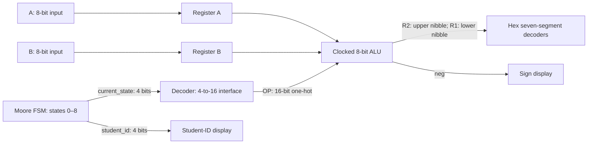
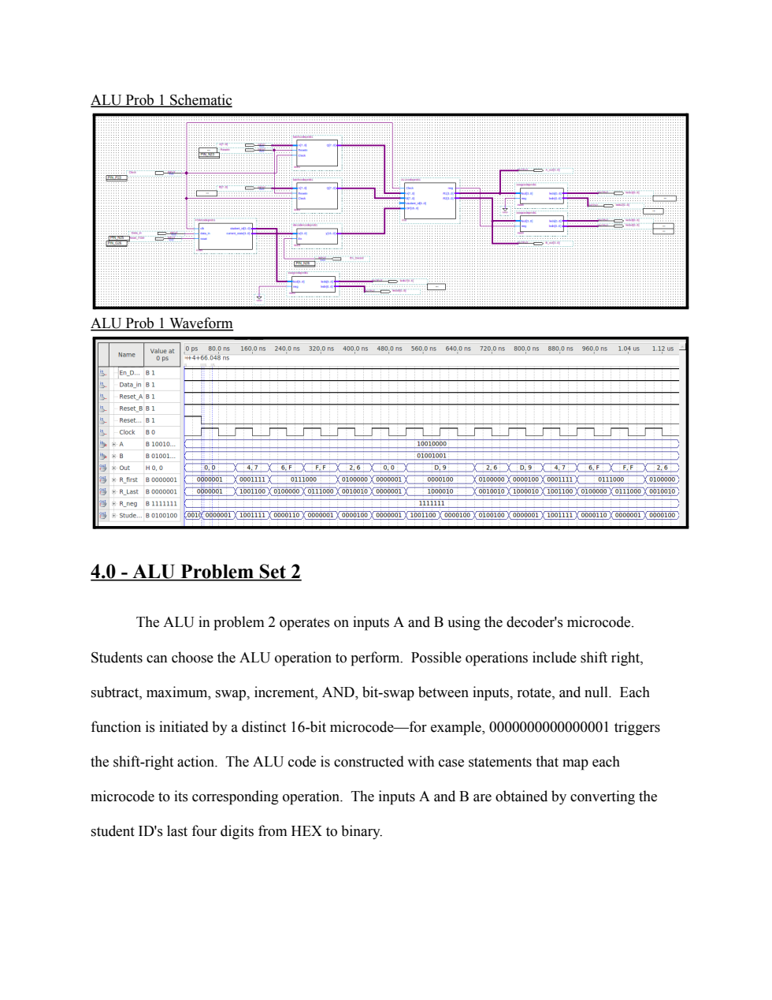

# FPGA General-Purpose Processor / 8-bit ALU

**VHDL · Quartus II · FSM control · Registered datapath · FPGA digital design**

A COE328 Digital Systems Lab 6 project integrating two 8-bit input registers, a nine-state Moore FSM, a 4-to-16 decoder interface, and a clocked ALU with seven-segment output. The project explores a baseline arithmetic/logic datapath, an assigned set of ALU functions, and a student-ID-driven odd/even display extension.

“General-purpose processor” follows the lab's title, *Design of a Simple General-Purpose Processor*. This is an educational, FSM-sequenced processing unit; the archived design does not establish a stored-program CPU with instruction memory, a program counter, or instruction fetching.

## Project highlights

- **Storage:** two rising-edge-triggered 8-bit registers capture operands A and B.
- **Control:** a Moore FSM sequences states 0–8; a decoder translates the 4-bit state into a 16-bit one-hot operation selector.
- **Computation:** nine baseline arithmetic/logic functions and a separate nine-function assigned ALU variant.
- **Output:** the 8-bit result is split into two nibbles for hexadecimal seven-segment decoding, with a separate negative indicator. A modified display produces `y`/`n` from student-ID digits.
- **Verification artifacts:** component and integrated `.vwf` files, expected-output tables, schematics, and waveform captures in the original report.
- **Hardware:** deployed on an Altera FPGA board according to the author's project account. The archived component build identifies a Cyclone II EP2C35F672C6; the board model and full-system programming evidence are not archived.

**Operation count:** the 16-bit selector is not a set of 16 implemented instructions. The saved decoder asserts only bits 0–8; states 9–15 and disabled decoding produce zero. Problems 1 and 2 are separate variants using those same nine selector values.

## Architecture



The FSM advances on a rising clock edge when `data_in = 1` and holds when it is zero. Its reset is active high; the input registers' reset is active low. The ALU also updates on a rising edge, so it reads the operand-register and decoded-state values present **before** that edge. New register/FSM values propagate afterward. Waveform comparisons must account for this sequencing.

Problem 3's report describes a simpler FSM-to-display odd/even path. Its archived schematic still references a missing ALU entity, so the report's simplified description should not be read as proof that the saved schematic is complete.

## Operations

The table maps the saved VHDL behavior. Numeric examples use the report's operands **A = `0x90`, B = `0x49`** and are calculated expectations, not results of a new simulator run. Arithmetic results are 8 bits and wrap modulo 256.

| State | OP (hex, 16 bits) | Problem 1 | Expected | Problem 2: saved behavior | Expected |
| --- | --- | --- | --- | --- | --- |
| 0 | `0001` | A + B | `D9` | Shift A right 2, fill with ones | `E4` |
| 1 | `0002` | A − B | `47` | A − B + 4 | `4B` |
| 2 | `0004` | NOT A | `6F` | Unsigned max(A, B) | `90` |
| 3 | `0008` | A NAND B | `FF` | B's low nibble followed by A's low nibble | `90` |
| 4 | `0010` | A NOR B | `26` | A + 1 | `91` |
| 5 | `0020` | A AND B | `00` | A AND B | `00` |
| 6 | `0040` | A XOR B | `D9` | Invert A's upper nibble | `60` |
| 7 | `0080` | A OR B | `D9` | Rotate B **right** 3 | `29` |
| 8 | `0100` | A XNOR B | `26` | Zero | `00` |

Problem 2 corresponds to manual assignment **(d)**, with a material discrepancy: function 8 requires rotate-left by 3 (`4A` for `49`), while the saved bit assignments implement rotate-right by 3 (`29`). The historical report lists the required `4A`. The original source is preserved; this documentation does not claim the mismatch was fixed or verified.

Problem 3 corresponds to assignment **(a)**: display `y` for odd student-ID digits and `n` for even digits, implemented by testing `bcd(0)`. This tests numeric odd/even status, not the parity of all four bits.

Source: [baseline ALU](Lab6_ProjectFiles/ALU_Problem1/ALUcodeprob1.vhd.bak), [assigned ALU](Lab6_ProjectFiles/ALU_Problem2/ALUproblem2code.vhd.bak), [modified display](Lab6_ProjectFiles/Components/Modified_sseg/modifiedSseg.vhd.bak).

## Schematics and waveform verification

This rendered page from the original report contains the baseline integrated schematic and historical waveform capture. It is not a newly generated simulation.



Explore the [evidence gallery and verification notes](docs/verification.md) for Problems 2 and 3, source waveform files, expected outputs, and limitations. See the [original report](COE328%20Lab%206%20Report%20GIT.pdf) for component truth tables and the full design narrative.

## Repository guide

```text
README.md                         Project overview and operation map
docs/
  verification.md                 Evidence, discrepancies, and rerun checklist
  reproduction.md                 Quartus recovery and repository organization
  portfolio.md                    Resume summary and metadata suggestions
  assets/                         Original-report page renders
Lab6_ProjectFiles/
  ALU_Problem1/                   Baseline ALU, schematic, symbol, waveform
  ALU_Problem2/                   Assigned ALU, schematic, symbol, waveform
  ALU_Problem3/                   Extension schematic, symbol, waveform
  Components/                    FSM, decoder, register, display sources
COE328 Lab 6 Report GIT.pdf       Original project report
```

Original paths are retained to preserve the archive and schematic references. Documentation and evidence now have a dedicated home under `docs/`.

## Tools and skills

**VHDL**, **Quartus II schematic/symbol integration**, **functional waveform simulation**, **Moore FSM design**, **register-transfer behavior**, **one-hot control decoding**, **8-bit arithmetic and bit manipulation**, and **seven-segment display interfacing**.

The archived component reports identify **Quartus II 13.0.1 SP1** and **Cyclone II EP2C35F672C6**. They describe top-level `ssegcode`, not an integrated processor build; their utilization figures must not be attributed to the complete processor.

## Opening and reproducing the project

Start with the [reproduction guide](docs/reproduction.md). This is a historical design archive, not a ready-to-build Quartus project: `.qpf`/`.qsf` settings are absent, VHDL is saved as `.vhd.bak`, some schematic entity names do not match available sources, and Problem 2 contains an undeclared `LR2` output assignment. No fresh synthesis, simulation, timing closure, or FPGA programming is claimed by this documentation update.

## Academic context

Created for COE328 Digital Systems, Lab 6. Requirements were checked against the supplied *Lab 6: Design of a Simple General-Purpose Processor* manual: Parts II–VI, Table 1, Problem 2(d), and Problem 3(a). The course manual is not redistributed here. Original implementation files and the report are retained for traceability; documented inconsistencies remain visible.

Use this repository to understand the design and its development. Follow your institution's academic-integrity rules and do not submit this work as your own.

For a concise project description, see [portfolio wording](docs/portfolio.md).
