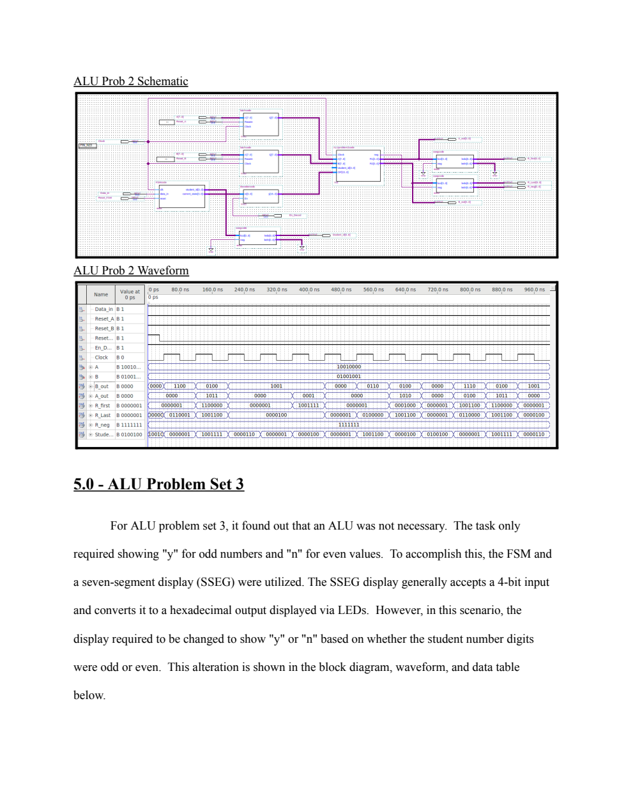
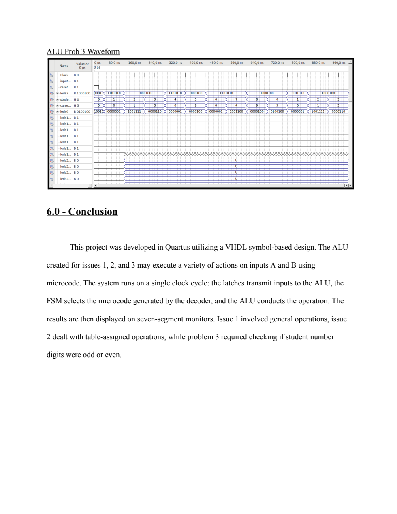

# Verification and evidence

## What is archived

The [original report](../COE328%20Lab%206%20Report%20GIT.pdf) contains expected-output tables and screenshots of Quartus waveforms. Page references below are one-based PDF page positions. Images are full-page renders of that report, with no altered signals or fabricated traces.

- **Problem 1:** expected-output table on PDF page 8; schematic and waveform on page 10. [Waveform file](../Lab6_ProjectFiles/ALU_Problem1/ALUprob1wave.vwf).
- **Problem 2:** expected-output table on PDF page 11; schematic and waveform on page 14. [Waveform file](../Lab6_ProjectFiles/ALU_Problem2/ALUprob2wave.vwf).
- **Problem 3:** odd/even table on PDF page 15; schematic on page 16; waveform on page 17. [Waveform file](../Lab6_ProjectFiles/ALU_Problem3/ALUprob3wave.vwf).
- Component waveforms are retained under `Components/Latch`, `Components/Decoder`, and `Components/FSM`.

## Baseline datapath

For A=`90`, B=`49`, the calculated nine-operation sequence is `D9, 47, 6F, FF, 26, 00, D9, D9, 26`. The report capture contains these result values across the sequence, including startup behavior. It does not establish exhaustive input coverage or an automated pass/fail test suite. The capture does not expose every internal state/control signal needed for a complete cycle-by-cycle audit.

## Assigned ALU

The manual's assignment (d) expects `E4, 4B, 90, 90, 91, 00, 60, 4A, 00` for the same operands. The saved source's function 8 instead computes `29`: assignments `Result(0) <= Reg2(3)` through `Result(7) <= Reg2(2)` rotate right. Do not label this capture as proving all manual requirements passed. The saved source also ends with `LR2 <= Result(7 downto 4)` although the declared output is `R2`, preventing compilation as written.

Function 2's `neg` flag tests `B > A`, without considering the subsequent +4. It therefore is not a general sign test for A−B+4. Function 4 constructs one output byte from B's low nibble and A's low nibble; it does not modify both operands.

## Student-ID extension

The modified display tests the low bit of the digit to select `y` or `n`. The waveform includes unknown (`U`) and don't-care/unknown traces on some additional outputs; this image is historical evidence, not a clean full-system pass. The saved schematic references `ALUproblem3code`, whose VHDL is absent. The report describes using only the FSM and display, so the exact final integrated build cannot be reconstructed from the archive alone.

## Hardware evidence

The author reports deployment on an Altera FPGA board. The archive contains `.sof`, `.pof`, pin and compilation artifacts in `Components/Latch/output_files`, but the flow report identifies **ssegcode** as its top-level entity. These artifacts establish a historical display-component build targeting Cyclone II EP2C35F672C6, not the complete processor's resource use, pinout, timing, or board programming success.

A useful future addition is an actual board photo or demonstration recording identifying the board, input values, selected function, and visible result. No board photograph or synthetic hardware demonstration has been added.

## Suggested verification after recovering the build

1. Recover consistent `.vhd` sources, symbols, top-level settings, and board pin assignments as described in [reproduction](reproduction.md).
2. Assert the FSM's active-high reset and both registers' active-low reset correctly, then release them before recording results.
3. Hold operands stable, enable the decoder and FSM, and record registered operands, state, OP, R2, R1, and neg. Compare against the pre-edge state and operands, allowing for clocked updates.
4. Exercise all nine operations in each variant. Confirm disabled decoding and unsupported selectors produce zero on the next ALU clock edge.
5. Add boundary cases: `00`, `FF`, equal operands, A<B, overflow, and values that distinguish rotate-left from rotate-right. Test FSM hold/wraparound and odd/even digits.
6. Check display polarity and segment ordering against the actual board. The regular and modified display sources use different conventions; the negative-display lookup does not establish general 8-bit signed-magnitude formatting.
7. Save stimulus, observed output, simulator/tool version, top-level name, and a clear pass/fail comparison. Keep new runs separate from historical captures.

No HDL toolchain or hardware verification was performed during the documentation update. Expected bytes were independently calculated; documentation links and source preservation were checked.
